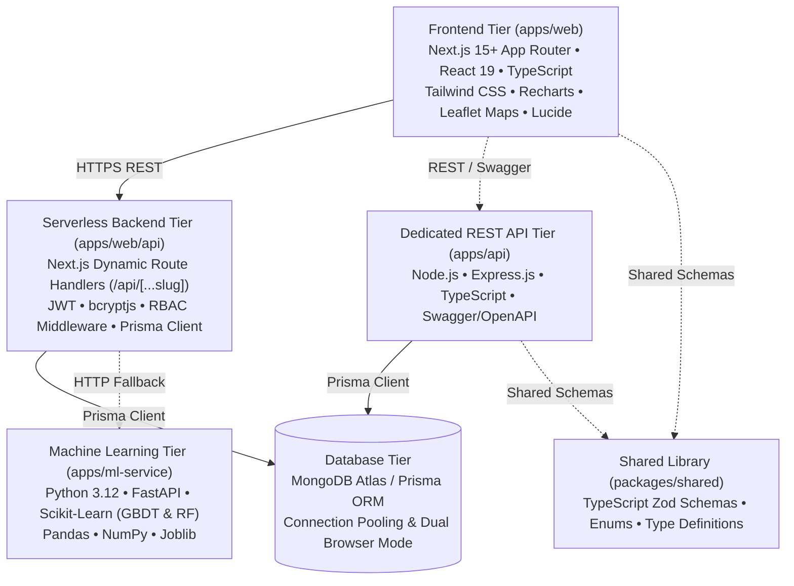

# 🍱 FoodBridge AI — Complete Project Handover & Technical Report

**Document Date:** November 16, 2026  
**Repository:** [https://github.com/RajvardhanSR/FoodBridge](https://github.com/RajvardhanSR/FoodBridge)  
**Live Website URL:** [https://food-bridge-sepia-rho.vercel.app](https://food-bridge-sepia-rho.vercel.app)  
**Local Development:** `http://localhost:3000` (AI Suite: `http://localhost:3000/dashboard/ai`)  
**Project Objective:** AI-Powered Food Waste Reduction & Hunger Relief Platform connecting food donors (restaurants, banquets, hostels) with verified hunger relief shelters and volunteer logistics networks in real time.

---

## 📑 Table of Contents
1. [Executive Summary](#1-executive-summary)
2. [Project Architecture & Monorepo Structure](#2-project-architecture--monorepo-structure)
3. [Chronological Work Log & Milestones Completed](#3-chronological-work-log--milestones-completed)
4. [Debugging & Root Cause Analysis (Bugs Fixed)](#4-debugging--root-cause-analysis-bugs-fixed)
5. [The New Agentic AI Demand Forecast Layer](#5-the-new-agentic-ai-demand-forecast-layer)
6. [Future AI Expansion Proposals](#6-future-ai-expansion-proposals)
7. [Comprehensive Deep Dive: ESG Certificates](#7-comprehensive-deep-dive-esg-certificates)
8. [Local Development & Deployment Guide](#8-local-development--deployment-guide)

---

## 1. Executive Summary

FoodBridge AI addresses two simultaneous global challenges: **urban food waste** and **local hunger**. 

Commercial kitchens routinely discard large quantities of untouched, high-quality cooked meals due to overproduction buffers and unpredictable footfall. Concurrently, nearby homeless shelters, community kitchens, and orphanages struggle with erratic food supply.

FoodBridge provides an intelligent bridge between both sides through:
- **A 6-Factor Dynamic Matching Algorithm** (Haversine spatial proximity, quantity fit, strict dietary validation, expiry half-life decay, shelter intake capacity, and urgency).
- **Predictive Regressors** (Gradient Boosting & Random Forest) for food surplus and shelter demand estimation.
- **An Agentic Demand Forecast Layer** incorporating past trend velocity and seasonal/climate multipliers.
- **A Dual Execution Engine** supporting instant zero-config 1-Click Evaluation via browser storage alongside a live MongoDB Atlas cloud database.

---

## 2. Project Architecture & Monorepo Structure



### Directory Breakdown

```text
FoodBridge/
├── apps/
│   ├── web/                        # Next.js 15+ Full-Stack Web Application
│   │   ├── prisma/
│   │   │   └── schema.prisma       # MongoDB Schema Definitions
│   │   ├── src/
│   │   │   ├── app/
│   │   │   │   ├── (auth)/         # Login, Register, Signup
│   │   │   │   ├── (dashboard)/
│   │   │   │   │   ├── dashboard/donor/      # Donor Surplus Dashboard & Creation
│   │   │   │   │   ├── dashboard/ngo/        # NGO Shelter Demands & Matches
│   │   │   │   │   ├── dashboard/volunteer/  # Volunteer Delivery Pipeline
│   │   │   │   │   ├── dashboard/admin/      # System Administration & Audit Logs
│   │   │   │   │   ├── dashboard/ai/         # AI Demand & Surplus Intelligence Suite
│   │   │   │   │   ├── map/                  # City-Wide Food Rescue Map (Leaflet)
│   │   │   │   │   └── analytics/            # Impact Analytics & Trends
│   │   │   │   └── api/[...slug]/  # Serverless Dynamic Catch-All Route Handlers
│   │   │   ├── components/         # Reusable UI components & layouts
│   │   │   └── lib/
│   │   │       ├── api.ts          # Unified API Client (Transparent Dual-Routing)
│   │   │       ├── authContext.tsx # Authentication Provider & Persona Switcher
│   │   │       └── demoStorage.ts  # In-Browser LocalStorage Evaluation Engine
│   │   └── package.json
│   ├── api/                        # Standalone Express.js Layered REST API
│   │   ├── src/
│   │   │   ├── modules/ (ai, auth, donations, ngos, pickups, impact)
│   │   │   └── server.ts
│   │   └── package.json
│   └── ml-service/                 # Python FastAPI Machine Learning Microservice
│       ├── main.py                 # REST Endpoints (/predict/surplus, /predict/demand)
│       ├── train.py                # Scikit-Learn Training & Serialization Pipeline
│       ├── dataset.py              # Synthetic Data Generator for Benchmarks
│       ├── test_ml.py              # Pytest Suite
│       └── requirements.txt
├── packages/
│   └── shared/                     # Shared TypeScript Types & Zod Schemas
├── prisma/                         # Root Prisma ORM Schema & Seeds
├── DEPLOYMENT.md                   # Cloud Production Deployment Guide
└── package.json                    # Monorepo Workspaces Configuration
```

---

## 3. Chronological Work Log & Milestones Completed

### Phase 1: Cloning & Workspace Setup
1. Cloned upstream repository `https://github.com/XxLiebexX/FoodBridge.git` to local environment.
2. Verified Node.js (`v23.11.0`) and Python (`3.12.5`) runtimes.
3. Created environment configuration files:
   - Root `.env` (configured for development ports `3000`, `5001`, `8001`).
   - `apps/web/.env.local` for Next.js client environment.

### Phase 2: Dependency Installation & Monorepo Compilation
1. Resolved sandboxed network execution and installed all npm workspace dependencies (`npm install`).
2. Compiled `@foodbridge/shared` TypeScript package (`npm run build:shared`).
3. Generated Prisma Client (`v5.22.0`).
4. Initialized Python virtual environment (`apps/ml-service/.venv`) and installed ML dependencies (`fastapi`, `uvicorn`, `scikit-learn`, `pandas`, `numpy`, `joblib`, `pytest`, `httpx`).

### Phase 3: ML Model Training & Test Verification
1. Ran Scikit-Learn training pipeline (`python train.py`):
   - **Surplus Regressor (Gradient Boosting):** Trained on 3,000 samples. Achieved $MAE = 18.52\text{ kg}$, $RMSE = 29.11\text{ kg}$, $R^2 = 0.451$.
   - **Demand Regressor (Random Forest):** Trained on shelter distribution logs. Achieved $MAE = 4.09\text{ kg}$, $RMSE = 6.37\text{ kg}$, $R^2 = 0.988$.
2. Ran complete test suites:
   - Python ML Pytest: **4 passed** in 1.40s.
   - Node.js Jest API Test Suite: **3 suites passed, 7 tests passed** (Matching algorithm, Auth RBAC, Environmental Impact calculations).
3. Verified Next.js web production build: **18 static and dynamic routes compiled successfully**.

### Phase 4: Git Migration & Vercel Deployment
1. Transferred Git origin remote to user's personal GitHub account:
   `https://github.com/RajvardhanSR/FoodBridge.git`
2. Staged local dependencies and serialized metrics, created commit, and pushed to `main`.
3. Guided user through successful cloud deployment on **Vercel**.

---

## 4. Debugging & Root Cause Analysis (Bugs Fixed)

During runtime testing of the deployed and local web application, three significant issues were reported and resolved:

### Bug 1: Blank Forecast Chart on `/dashboard/ai`
* **Symptoms:** The "Projected Surplus vs Shelter Demand" chart showed a blank white card with no lines or areas, and the "Why this prediction?" box was empty.
* **Root Cause:**
  - `apps/web/src/lib/demoStorage.ts` and `apps/web/src/app/api/[...slug]/route.ts` returned a flat array: `[{ day, predicted_surplus_kg, ... }]`.
  - The UI component (`/dashboard/ai/page.tsx`) expected an object: `{ forecast: [...], insights: [...] }` with camelCase keys (`predictedSurplusKg` and `predictedDemandKg`).
  - Because `forecasts?.forecast` was `undefined`, Recharts rendered an empty container.
* **Solution:** Standardized both the mock engine and the serverless route handler to return:
  ```json
  {
    "forecast": [
      { "day": "Mon", "predictedSurplusKg": 95.2, "predictedDemandKg": 104.5, "predictedMeals": 261, "confidencePercent": 89 }
    ],
    "insights": ["Surplus food availability peaks on Friday & Saturday evenings by +38%..."]
  }
  ```

### Bug 2: Crash / Error when clicking "Run ML Model"
* **Symptoms:** Clicking "Run ML Model" threw an unhandled error or failed silently.
* **Root Cause:**
  1. The API route and demo storage returned `confidence_range: { lower_kg, upper_kg }` instead of `expected_range: { min_kg, max_kg }`.
  2. The frontend read `predictedResult.expected_range.min_kg` and `predictedResult.confidence_score * 100`. Because these fields were missing, JavaScript threw `TypeError: Cannot read properties of undefined (reading 'min_kg')` or rendered `NaN`.
  3. The page only had a Donor form ("Expected Patrons", "Donor Type") and had no handler for NGO demand prediction.
* **Solution:**
  - Added full `expected_range: { min_kg, max_kg }`, `confidence_score`, and `explanation` across `demoStorage.ts`, `api.ts`, and `route.ts`.
  - Added safe optional chaining (`predictedResult?.expected_range?.min_kg ?? ...`) to prevent crashes.

### Bug 3: Webpack Module Runtime Error (`__webpack_modules__[moduleId] is not a function`)
* **Symptoms:** A red error overlay appeared stating `Runtime TypeError: __webpack_modules__[moduleId] is not a function`.
* **Root Cause:** Running `npm run build:web` (`next build`) while `npm run dev:web` (`next dev`) was concurrently active in the background caused production chunks to overwrite development chunks in `.next/`. Webpack's in-memory chunk registry in the browser became mismatched with disk files.
* **Solution:** Terminated the background dev process, purged `.next/` cache (`rm -rf apps/web/.next`), and restarted `npm run dev:web` cleanly. Compilation succeeded with `HTTP 200 OK`.

---

## 5. The Three Specialized AI Forecast Engines

To provide each persona with a tailored, actionable experience, FoodBridge features three dedicated forecasting engines rather than a one-size-fits-all view:

```
┌─────────────────────────────────────────────────────────────────────────────────────────┐
│                           FoodBridge AI Forecasting Suite                               │
├───────────────────────────────┬─────────────────────────────┬───────────────────────────┤
│ 🍱 AI Surplus Forecast        │ 🤖 AI Demand Forecast       │ 🌐 AI Platform Forecast   │
│ Route: /dashboard/ai/surplus  │ Route: /dashboard/ai/demand │ Route: /dashboard/ai/platform
│ Persona: Donors & Kitchens    │ Persona: NGOs & Shelters    │ Persona: Admins & Ops     │
└───────────────────────────────┴─────────────────────────────┴───────────────────────────┘
```

1. **AI Surplus Forecast (`/dashboard/ai/surplus`)** — Donor & Kitchen Waste Regressor:
   - Evaluates expected customer footfall, commercial kitchen type (fine dining, casual, corporate buffet, bakery), and special banquet buffers.
   - Outputs predicted surplus kg, portion counts, waste disposal savings ($), landfill diversion rates, and category waste distributions.

2. **AI Demand Forecast (`/dashboard/ai/demand`)** — Agentic NGO & Shelter Demand Engine:
   - Predicts intake requirements for homeless shelters, community kitchens, and orphanages.
   - Integrates past trend velocity (accelerating vs volatile) and environmental/climate shocks (severe winter cold wave +45%, monsoon rains +30%, festival rush +35%).
   - Generates cognitive 4-step reasoning chains, dynamic variance windows, and prescriptive volunteer alerts.

3. **AI Platform Forecast (`/dashboard/ai/platform`)** — City-Wide Deficit & Operations Radar:
   - Macro supply/demand equilibrium engine monitoring city-wide balance ratio (e.g. 108.4% surplus cushion).
   - Zone-by-zone Deficit Radar Table across Central Delhi, North Delhi, South Delhi, West Delhi, East Delhi, and Noida Sector Hub.
   - Interactive City-Wide Network Stress Simulator modeling real-world shocks (courier shortages, extreme weather, donor participation levels).
   - Automated Inter-Zone Corridor Directives (e.g. Corridor Alpha: South Delhi -> North Delhi inter-district transfer).

### 1. Dynamic Trend & Seasonality Multipliers

Rather than using static regression, the agent applies multi-variable environmental and operational factors:

| Factor Type | Options Available | Operational Impact on Demand |
| :--- | :--- | :--- |
| **Past Trend Velocity** | • Accelerating Intake<br>• Stable 30-Day Moving Avg<br>• High Day-to-Day Volatility | • $+15\%$ upward demand slope<br>• Baseline moving average<br>• $+8\%$ dynamic safety stock expansion |
| **Seasonality & Climate** | • Severe Winter Cold Wave<br>• Festive Season Rush<br>• Monsoon Heavy Rain<br>• Summer Heatwave<br>• Normal Season | • $+45\%$ night shelter bed occupancy & hot meals<br>• $+35\%$ footfall spike around community grounds<br>• $+30\%$ emergency dry rations due to flooding<br>• Perishable spoilage protection & hydration<br>• Baseline standard |
| **Scheduled Drive** | Checkbox toggle | Adds $+30\%$ contingency buffer for outreach drives |

### 2. Multi-Step Cognitive Chain-of-Thought Output

When the user runs the forecast, the agent renders four structured outputs:
1. **Hero Forecast Metrics:** Predicted Demand in kg, hot meal equivalents, dynamic confidence intervals ($min\text{ kg} - max\text{ kg}$), and priority rating (`CRITICAL`, `HIGH`, `MEDIUM`).
2. **Category Allocation:** Cooked meals (60%), raw produce (22%), bakery (10%), packaged staples (8%).
3. **Step-by-Step Reasoning Logs:**
   - **Step 1 (Perception):** Analyzes historical 30-day intake velocity for the specific shelter type.
   - **Step 2 (Seasonality):** Evaluates meteorological and calendar factors.
   - **Step 3 (Synthesis):** Computes final regressed target demand and confidence bounds.
4. **Prescriptive Action Plan:** 3 actionable interventions (e.g. *"Auto-query 4 high-capacity donor banquets within 4.0 km radius by 6:00 PM"*, *"Reserve 2 volunteer couriers with thermal insulated transport"*).
5. **Interactive Scenario Projection:** Overlays the simulated scenario directly onto the Recharts area chart for the upcoming 7-day or 14-day window.

---

## 6. Future AI Expansion Proposals

To elevate FoodBridge into an industry-leading platform, five high-impact AI capabilities have been architected:

### 1. 📸 Multimodal Food Freshness & Quality Scanner (Vision AI)
- **Concept:** Donors snap a picture of food trays instead of weighing food manually.
- **Model:** Gemini 2.0 Flash / Vision API.
- **Output:** Identifies dishes, estimates container volume & weight in kg, checks visual freshness/discoloration, and calculates a safe consumption window (countdown timer).

### 2. 🎙️ Voice & WhatsApp "Zero-Friction" Donation Bot (Conversational AI)
- **Concept:** Banquet managers and chefs speak in natural language (English, Hindi, Hinglish) via audio note or chat at 11:30 PM.
- **Model:** LLM Function Calling & Entity Extraction.
- **Output:** Extracts category, quantity, address, and expiry deadline, and auto-publishes the donation ticket in under 2 seconds.

### 3. 🚚 Autonomous Logistics & Multi-Stop Route Optimizer (Logistics Agent)
- **Concept:** Solves the Vehicle Routing Problem with Time Windows (VRPTW).
- **Model:** Google OR-Tools in `apps/ml-service`.
- **Output:** Bundles multiple small donor pickups (e.g., 3 restaurants within 2 km) into a single optimized vehicle route with priority given to dishes expiring first.

### 4. 🗺️ Geospatial Predictive Hunger Heatmap (Spatial AI)
- **Concept:** Replaces static map pins with a predictive "weather radar for hunger".
- **Model:** Kernel Density Estimation (KDE) + Weather Feeds.
- **Output:** Identifies hunger deficit zones 48–72 hours in advance and alerts commercial donors in that radius to pledge surplus early.

### 5. 📄 Automated ESG & Carbon Offset Report Generator (Generative AI)
- **Concept:** Generates certified environmental impact and CSR sustainability audits for corporate donors and restaurant chains.

---

## 7. Comprehensive Deep Dive: ESG Certificates

### What is ESG?
- **E (Environmental):** How a company protects the planet. Food waste rotting in landfills produces **methane** ($CH_4$), a greenhouse gas 28 times more potent than carbon dioxide ($CO_2$), while wasting thousands of liters of embedded agricultural water.
- **S (Social):** Direct humanitarian contribution to United Nations Sustainable Development Goals (SDG 2: Zero Hunger) by feeding local vulnerable populations.
- **G (Governance):** Transparent, auditable, and tamper-proof digital records verifying that food was safely inspected and lawfully donated without fraud.

### Why Commercial Donors Want This
1. **Mandatory CSR Compliance:** Under corporate laws (such as Section 135 of the Companies Act in India), qualifying companies are legally obligated to allocate **2% of their net profits to CSR**. An ESG certificate provides verifiable proof.
2. **Tax Deductions:** Donations to registered non-profits qualify for tax relief (e.g. Section 80G in India, 501(c)(3) in the US).
3. **Brand Marketing & Investor Standards:** Institutional investors (e.g., BlackRock) grade companies on ESG ratings. Hotels and caterers display these certificates as proof of their zero-waste commitment.

### Environmental Physics Formulae
$$\text{CO}_2\text{e Emissions Saved (kg)} = \text{Food Rescued (kg)} \times 1.9$$
$$\text{Fresh Agricultural Water Saved (Liters)} = \text{Food Rescued (kg)} \times 840$$
$$\text{Meals Provided} = \text{Food Rescued (kg)} \times 2.5$$

---

## 8. Local Development & Deployment Guide

### Prerequisites
- Node.js $\ge 18$ (Tested on `v23.11.0`)
- Python $\ge 3.11$ (Tested on `3.12.5`)
- Git

### Quick Start Commands

```bash
# 1. Clone the repository
git clone https://github.com/RajvardhanSR/FoodBridge.git
cd FoodBridge

# 2. Set up environment variables
cp .env.example .env
cp .env.example apps/web/.env.local

# 3. Install Monorepo Dependencies
npm install
npm run build:shared
npx prisma generate

# 4. Set up Python ML Microservice
cd apps/ml-service
python3 -m venv .venv
./.venv/bin/pip install -r requirements.txt
./.venv/bin/python train.py
cd ../..

# 5. Start Development Servers
# Terminal 1: Web Frontend (Next.js 15)
npm run dev:web

# Terminal 2: ML Service (FastAPI)
cd apps/ml-service && ./.venv/bin/python main.py
```

### Access Points
- **Web Application:** `http://localhost:3000`
- **AI Forecasting Suite:** `http://localhost:3000/dashboard/ai`
- **FastAPI ML Microservice:** `http://localhost:8001`
- **ML Swagger API Docs:** `http://localhost:8001/docs`

---
*Report generated for the FoodBridge AI project team.*
