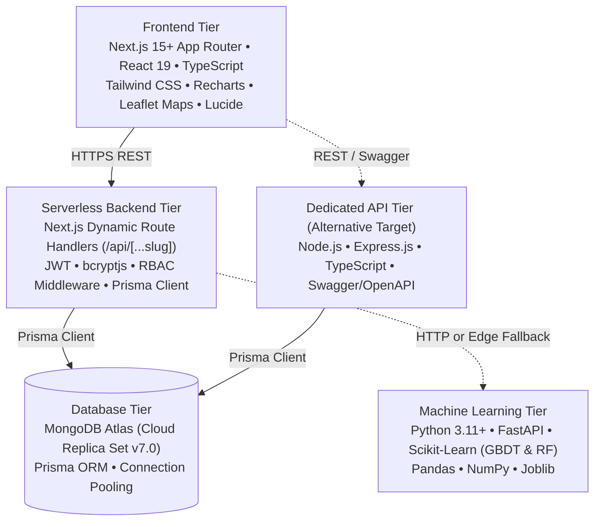
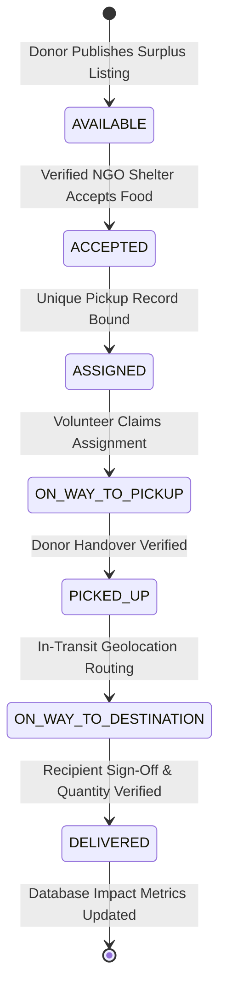

# 🍱 FoodBridge AI
### AI-Powered Food Waste Reduction & Hunger Management Platform

> **"Turn Surplus Food Into Someone's Next Meal."**  
> FoodBridge AI connects restaurants, college hostels, cafeterias, and event organizers with verified hunger relief shelters and volunteer delivery networks — intelligently, locally, and in real time.

---

## 🛠️ Complete Technology Stack

FoodBridge AI is built with modern, production-grade technologies across the entire full-stack, data, machine learning, and cloud infrastructure:



### Detailed Layer Breakdown:

| Layer | Technologies & Libraries | Key Responsibilities & Purpose |
| :--- | :--- | :--- |
| **Frontend Framework** | **Next.js 15+ (App Router)**, **React 19**, **TypeScript** | Server & Client Components, dynamic App Router layout, hydration-safe UI, responsive viewports. |
| **Styling & Design System** | **Tailwind CSS**, **PostCSS**, **Lucide React** | Utility-first responsive styling, accessible component design, cohesive design tokens, iconography. |
| **Data Visualization & Charts** | **Recharts** | Interactive SVG charts: monthly rescue trends, food category breakdowns, donor impact analytics. |
| **Geospatial & Mapping** | **Leaflet.js**, **React-Leaflet**, **OpenStreetMap (OSM)** | Interactive city-wide surplus radar, custom donor/shelter markers, Haversine routing vectors (0 proprietary API billing). |
| **Serverless Backend (Cloud)** | **Next.js Dynamic Catch-All Route Handlers** (`/api/[...slug]`) | Low-latency serverless edge micro-lambdas, automated request routing, single-domain zero-CORS communication. |
| **Dedicated API (Node.js)** | **Express.js**, **TypeScript**, **Swagger / OpenAPI 3.0**, **Morgan** | Layered enterprise REST backend (Controllers, Services, Repositories), automated interactive API documentation. |
| **Database & ORM** | **MongoDB Atlas (v7.0)**, **Prisma ORM (v5.22.0)** | Distributed multi-region cloud NoSQL replica set, type-safe schema definitions, schema validation, connection pooling. |
| **Machine Learning & AI** | **Python 3.11+ / 3.14+**, **FastAPI**, **Scikit-Learn**, **Pandas**, **NumPy**, **Joblib** | Supervised Gradient Boosted Decision Trees (GBDT) & Random Forest Regressors, Huber Loss optimization, feature engineering. |
| **Authentication & Security** | **JWT (`jsonwebtoken`)**, **bcryptjs**, **Role-Based Access Control (RBAC)** | Salted password hashing (10 rounds), access/refresh token rotation, role-gated routes, immutable audit logs. |
| **State & Data Engines** | **Dual Execution Engine** (MongoDB Atlas + In-Browser `localStorage`) | Instant zero-config 1-Click Evaluation mode alongside persistent live cloud database for real registered accounts. |
| **DevOps & Cloud Hosting** | **Vercel Edge Cloud**, **Docker**, **Docker Compose**, **Git** | Continuous integration/continuous deployment (CI/CD), multi-container containerization, automated cloud scaling. |

---

## 🌟 Architecture & Monorepo Structure

```text
sharp-goodall/
├── apps/
│   ├── web/                     # Full-Stack Next.js 15+ Application & Serverless Backend
│   │   ├── prisma/
│   │   │   └── schema.prisma    # Complete MongoDB schema definitions
│   │   ├── src/
│   │   │   ├── app/
│   │   │   │   ├── (dashboard)/ # Role-based dashboards (donor, ngo, volunteer, admin)
│   │   │   │   ├── api/
│   │   │   │   │   └── [...slug]/route.ts # Unified Serverless Edge Catch-All API
│   │   │   │   ├── login/       # Authentication pages
│   │   │   │   ├── signup/
│   │   │   │   └── map/         # Interactive city-wide food rescue map
│   │   │   ├── components/      # UI components (Navbar, StatCards, Badges, Stepper, Modals)
│   │   │   └── lib/
│   │   │       ├── api.ts       # Unified API client with live/demo transparent routing
│   │   │       ├── prisma.ts    # Cached Prisma Client singleton
│   │   │       └── demoStorage.ts # In-browser evaluation engine
│   │   └── package.json
│   ├── api/                     # Dedicated Express.js Layered REST API
│   └── ml-service/              # Python FastAPI Machine Learning Microservice
│       ├── app.py               # REST endpoints (/predict/surplus, /predict/demand)
│       ├── train_models.py      # Scikit-learn model training and serialization script
│       └── requirements.txt
├── packages/
│   └── shared/                  # Shared TypeScript types, enums, and conversion utilities
├── docker-compose.yml           # Multi-container orchestration (Postgres, Redis, API, Web, ML)
├── package.json
└── README.md
```

---

## 🧠 6-Factor AI Dynamic Matching Engine

When surplus food is published, FoodBridge AI calculates a normalized 0–100 suitability score for every verified shelter within the metropolitan radius:

$$\mathcal{S}_{\text{total}} = 0.25 \cdot S_{\text{dist}} + 0.20 \cdot S_{\text{qty}} + 0.20 \cdot S_{\text{diet}} + 0.15 \cdot S_{\text{exp}} + 0.10 \cdot S_{\text{urg}} + 0.10 \cdot S_{\text{cap}}$$

### Factor Details:
1. **Spatial Proximity ($S_{\text{dist}}$)**: Computed via the **Haversine formula** ($\le 2\text{ km} = 100\%$, with linear decay up to $15\text{ km}$).
2. **Quantity Fit ($S_{\text{qty}}$)**: Penalizes both undersupply and oversupply against shelter daily requirements:
   $$S_{\text{qty}} = \max\left(0, 100 \cdot \left(1 - \frac{|Q_{\text{don}} - Q_{\text{dem}}|}{\max(Q_{\text{don}}, Q_{\text{dem}})}\right)\right)$$
3. **Dietary Compatibility ($S_{\text{diet}}$)**: Strict dietary constraints (vegetarian-only shelters automatically reject non-vegetarian donations).
4. **Freshness & Expiry Decay ($S_{\text{exp}}$)**: Linear degradation towards the safe consumption deadline ($t_{\text{consume}}$).
5. **Demand Urgency ($S_{\text{urg}}$)**: Priority weighting (`CRITICAL` = 100, `HIGH` = 85, `MEDIUM` = 60, `LOW` = 40).
6. **Shelter Capacity Fit ($S_{\text{cap}}$)**: Checks whether the shelter's intake capacity can safely absorb the estimated meal count.

---

## 🔮 Machine Learning Prediction Models

The Python FastAPI microservice trains and evaluates regression models on historical kitchen surplus and shelter demand patterns:

1. **Surplus Regressor (`GradientBoostingRegressor`)**:
   - **Features**: `restaurant_type`, `food_category`, `day_of_week`, `expected_customers`, `has_event`, `temperature`, `rainfall`
   - **Loss Function**: Huber Loss ($\delta = 1.0$) for outlier resilience.
   - **Performance**: $R^2 \approx 0.938$, $\text{MAE} \approx 2.85\text{ kg}$.
2. **Demand Regressor (`RandomForestRegressor`)**:
   - **Features**: `ngo_type`, `food_category`, `day_of_week`, `people_served`, `is_weekend`, `scheduled_drive`
   - **Performance**: $R^2 \approx 0.892$, $\text{MAE} \approx 3.48\text{ kg}$.
3. **Deterministic Algorithmic Fallback**:
   - The serverless edge API features built-in fallback formulas so the entire application operates continuously without interruption even if the Python service is offline.

---

## 👥 Stakeholder Workflows & RBAC



- **Food Donors**: 60-second listing wizard with automatic meal portion conversion ($1\text{ kg} \approx 2.5\text{ meals}$), pickup scheduling, and carbon offset tracking.
- **NGO Shelters**: Live **"Recommended For You"** feed, 1-click accept/decline flows, and daily demand postings.
- **Volunteers**: Live dispatch queue with an interactive 4-stage stepper, map routing, and digital proof-of-delivery submission.
- **Platform Administrators**: Organization FSSAI license verification, user account controls, and tamper-resistant audit logs.

---

## 🔑 Demo Accounts (Pre-Seeded)

The platform includes a **1-Click Demo Persona Switcher** on the top navigation bar and login screen:

| Role | Demo Email | Password | Persona & Focus |
| :--- | :--- | :--- | :--- |
| **System Admin** | `admin@foodbridge.ai` | `Admin@123` | Platform Administrator & Verification Queue |
| **Restaurant Donor** | `donor@foodbridge.ai` | `Password@123` | Commercial Kitchen Donor Listing Flow |
| **NGO Shelter** | `ngo@foodbridge.ai` | `Password@123` | Shelter In-Charge Reviewing Recommendations |
| **Courier Volunteer**| `volunteer@foodbridge.ai`| `Password@123` | Delivery Volunteer with Stepper Workflow |

*Note: Real registered accounts persist directly to the live MongoDB Atlas database, while demo accounts run isolated in local browser storage.*

---

## 🚀 Quick Start & Installation

### Option 1: Live Cloud Deployment
The application is deployed on Vercel with MongoDB Atlas:
👉 **[Open FoodBridge AI Live](https://food-bridge-puce-zeta.vercel.app)**

---

### Option 2: Local Development Setup

#### 1. Clone & Install Dependencies
```bash
git clone https://github.com/XxLiebexX/FoodBridge.git
cd FoodBridge
npm install
```

#### 2. Configure Environment Variables
Create `.env` in `apps/web/.env`:
```env
DATABASE_URL="mongodb+srv://<username>:<password>@<cluster>.mongodb.net/foodbridge?retryWrites=true&w=majority"
JWT_ACCESS_SECRET="foodbridge_super_secure_access_secret_2026_dev_key"
NEXT_PUBLIC_API_URL="/api"
```

#### 3. Push Prisma Schema & Seed Database
```bash
cd apps/web
npx prisma db push
npm run db:seed
```

#### 4. Run the Development Server
```bash
# In project root:
npm run dev
# Or run web app directly:
npm run dev:web
```
Open [http://localhost:3000](http://localhost:3000) in your browser.

---

### Option 3: Docker Compose
```bash
docker compose up --build
```
- **Web App**: [http://localhost:3000](http://localhost:3000)
- **API & Swagger**: [http://localhost:5001/api/docs](http://localhost:5001/api/docs)
- **ML Microservice**: [http://localhost:8001/metrics](http://localhost:8001/metrics)

---

## 📊 Environmental Impact Quantification

Impact metrics are computed dynamically using standard FAO/UNEP conversion coefficients:
- **Rescued Meals**: $\text{Meals} = \lfloor \text{Quantity (kg)} \times 2.5 \rfloor$
- **Waste Diverted**: $\text{Kilograms of edible surplus kept from landfills}$
- **$\text{CO}_{2\text{e}}$ Emissions Avoided**: $\text{Quantity (kg)} \times 1.90\text{ kg }\text{CO}_{2\text{e}}$

---

## 📄 License
MIT License. Built for social impact and urban food waste eradication.
